# MIMU — Diseño técnico de base de datos (v1.3 MVP)

**Estado:** propuesta de esquema para el MVP.  
**Motor:** PostgreSQL 15+.  
**Alcance operativo inicial:** una institución de demostración, sin datos semilla en estos archivos.  
**Objetivo de esta versión:** cubrir las pantallas existentes de Android y las operaciones web imprescindibles, aplazando funcionalidades no necesarias para la primera entrega.

> Este documento y `MIMU_postgresql_schema_v1.3_MVP.sql` deben mantenerse sincronizados. El SQL define las tablas activas del MVP; las funcionalidades aplazadas se describen para dejar claro que no forman parte de esta implementación.

## 1. Decisiones confirmadas

- **Idioma del esquema:** nombres de tablas, columnas, tipos, índices, restricciones y valores de estados/catálogos técnicos están en inglés. Los textos visibles para usuarios pueden mantenerse en el idioma elegido por el producto.
- **Compatibilidad del esquema:** el cambio de nombres del español al inglés es incompatible con una base existente que use v1.2. Para el MVP local, crear la base desde cero con v1.3; si ya existen datos que deban conservarse, preparar una migración explícita de renombrado y conversión de valores antes de aplicarlo.

- **Motor:** PostgreSQL 15 o superior.
- **Instituciones:** esquema preparado para multiinstitución; durante el MVP se utilizará una sola institución de demostración.
- **Roles:** `PARENT_GUARDIAN`, `TEACHER`, `SCHOOL_ADMIN` y `MIMU_SUPPORT_ADMIN`, con alcances separados.
- **Identificadores:** UUID versión 7 generados exclusivamente por la API/backend mediante una biblioteca confiable. PostgreSQL no genera IDs ni contiene valores por defecto para las columnas UUID. El script no usa UUIDv4 como sustituto.
- **Autenticación:** JWT de acceso de vida corta y refresh token opaco rotatorio persistido como hash.
- **Acceso a datos:** Android y la web se conectan exclusivamente a la API; nunca directamente a PostgreSQL.
- **Primer acceso:** cambio obligatorio de contraseña temporal y luego aceptación de la versión vigente de Términos y Condiciones.
- **Notas:** el educador guarda la calificación como borrador y la publica manualmente. Una vez publicada, cualquier edición guardada se refleja inmediatamente en Android; la edición no requiere republicación. El motor avanzado de promedios ponderados queda fuera del alcance del MVP.
- **Tareas:** cada estudiante tiene un estado `PENDING` o `SUBMITTED`. Solo el educador cambia el estado desde la web y puede corregirlo en ambos sentidos; al volver a `PENDING`, se limpia `submitted_at`. No se implementa carga de archivos desde Android.
- **Mensajes:** comunicados escolares unidireccionales con destinatarios y lectura individual. No hay chat ni conversaciones.
- **Notificaciones:** bandeja interna de notificaciones. El registro de dispositivos y el envío push se aplazan.
- **Home:** siempre opera en el contexto de un solo estudiante seleccionado por el tutor. Los contadores y datos por estudiante se filtran por ese estudiante; cambiar la selección actualiza el contexto. No se almacenan contadores independientes.
- **Contacto:** la información de la institución se obtiene de `institutions`; los datos de contacto de MIMU se configuran fuera del modelo de tickets.

## 2. Alcance funcional del MVP

| Pantalla o función | Incluido en el MVP | Fuera del MVP |
|---|---|---|
| Inicio de sesión | Autenticación y sesión de renovación | Flujos avanzados de administración de sesiones |
| Primer acceso | Cambio de contraseña temporal y aceptación de términos en ese orden | — |
| Home | Resumen y contadores derivados de datos reales por estudiante seleccionado | Contadores independientes mantenidos manualmente |
| Estudiantes y tutores | Relación de tutor con uno o varios estudiantes y tutor principal | Administración familiar avanzada |
| Seguimiento diario | Asistencia, alimentación y ánimo registrados desde la web | Analítica avanzada |
| Notas | Consultar calificaciones publicadas y registrar lectura por tutor | Motor ponderado avanzado, boletines y reportes administrativos complejos |
| Tareas | Publicación, destinatarios y estado individual pendiente/entregada | Entrega de archivos desde Android y revisión digital avanzada |
| Asistencia | Registro e historial básico | Reportes complejos |
| Avisos | Publicación y destinatarios | Automatizaciones no necesarias para las pantallas actuales |
| Eventos | Calendario, destinatarios y próximos eventos | Gestión avanzada de eventos |
| Mensajes | Bandeja de comunicados, destinatarios y estado de lectura | Chat, respuestas, hilos y tiempo real |
| Notificaciones | Bandeja interna, destinatario y estado de lectura | FCM/push, dispositivos y cola asíncrona dedicada |
| Perfil | Datos del usuario y datos básicos autorizados | Configuración de perfil avanzada no presente en el flujo |
| Contáctanos | Información de contacto escolar y de MIMU | Tickets, asignación, estados e historial de soporte |
| Administración web | Operaciones escolares mínimas necesarias para alimentar Android | Administración global avanzada y reportes extensos |
| Auditoría | Controles de autorización y registros operativos básicos en la aplicación/infraestructura | Módulo de auditoría administrativa avanzada |

## 3. Modelo entidad-relación

El diagrama resume las relaciones principales del esquema activo. Para legibilidad, no muestra todas las claves foráneas compuestas ni las tablas auxiliares de autenticación.

```mermaid
erDiagram
  INSTITUTIONS ||--o{ INSTITUTION_MEMBERSHIPS : has
  USERS ||--o{ INSTITUTION_MEMBERSHIPS : belongs_to
  USERS ||--|| CREDENTIALS : authenticates
  USERS ||--o{ USER_ROLES : receives
  ROLES ||--o{ USER_ROLES : assigned
  ROLES ||--o{ ROLE_PERMISSIONS : contains
  PERMISSIONS ||--o{ ROLE_PERMISSIONS : grants
  USERS ||--o{ REFRESH_SESSIONS : renews
  USERS ||--o{ PASSWORD_RESET_TOKENS : resets
  USERS ||--o{ TERMS_ACCEPTANCES : accepts
  TERMS_AND_CONDITIONS ||--o{ TERMS_ACCEPTANCES : versions

  INSTITUTIONS ||--o{ STUDENTS : registers
  USERS ||--o{ STUDENT_GUARDIANS : guardian
  STUDENTS ||--o{ STUDENT_GUARDIANS : linked_to
  INSTITUTIONS ||--o{ GRADE_LEVELS : defines
  INSTITUTIONS ||--o{ ACADEMIC_PERIODS : defines
  GRADE_LEVELS ||--o{ GROUPS : contains
  ACADEMIC_PERIODS ||--o{ GROUPS : organizes
  STUDENTS ||--o{ ENROLLMENTS : enrolled
  GROUPS ||--o{ ENROLLMENTS : includes
  INSTITUTIONS ||--o{ SUBJECTS : offers
  USERS ||--o{ TEACHING_ASSIGNMENTS : teaches
  GROUPS ||--o{ TEACHING_ASSIGNMENTS : assigned
  SUBJECTS ||--o{ TEACHING_ASSIGNMENTS : covers
  ACADEMIC_PERIODS ||--o{ TEACHING_ASSIGNMENTS : scopes

  TEACHING_ASSIGNMENTS ||--o{ ASSESSMENTS : defines
  ASSESSMENTS ||--o{ GRADE_RECORDS : produces
  STUDENTS ||--o{ GRADE_RECORDS : receives
  GRADE_RECORDS ||--o{ GRADE_READS : read
  USERS ||--o{ GRADE_READS : consults

  TEACHING_ASSIGNMENTS ||--o{ TASKS : publishes
  TASKS ||--o{ TASK_RECIPIENTS : targets
  TASKS ||--o{ TASK_ASSIGNMENTS : creates
  STUDENTS ||--o{ TASK_ASSIGNMENTS : has
  STUDENTS ||--o{ ATTENDANCE_RECORDS : records
  GROUPS ||--o{ ATTENDANCE_RECORDS : context
  STUDENTS ||--o{ DAILY_TRACKING : records

  INSTITUTIONS ||--o{ ANNOUNCEMENTS : publishes
  ANNOUNCEMENTS ||--o{ ANNOUNCEMENT_RECIPIENTS : targets
  INSTITUTIONS ||--o{ EVENTS : schedules
  EVENTS ||--o{ EVENT_RECIPIENTS : targets
  INSTITUTIONS ||--o{ MESSAGES : publishes
  MESSAGES ||--o{ MESSAGE_RECIPIENTS : targets
  MESSAGES ||--o{ MESSAGE_READS : read
  USERS ||--o{ MESSAGE_READS : reads
  USERS ||--o{ NOTIFICATIONS : receives
```

## 4. Catálogo de tablas activas

### 4.1 Identidad, institución y autorización

| Tabla | Responsabilidad en el MVP |
|---|---|
| `institutions` | Institución, estado, zona horaria y teléfono/correo de contacto escolar. |
| `users` | Identidad global, correo normalizado, estado y banderas del primer acceso. |
| `credentials` | Hash de contraseña, bloqueo e información del último acceso. Nunca almacena contraseñas en claro. |
| `institution_memberships` | Relación entre usuario e institución. |
| `roles`, `permissions`, `role_permissions`, `user_roles` | RBAC. Los roles deben sembrarse mediante una migración posterior, no con datos de demostración. |
| `refresh_sessions` | Hash de refresh token, familia de rotación, cliente y revocación. |
| `password_reset_tokens` | Tokens de recuperación almacenados como hash, con vencimiento y uso. |
| `terms_and_conditions`, `terms_acceptances` | Versiones publicadas y evidencia de aceptación por usuario. |

### 4.2 Estructura escolar y académica

| Tabla | Responsabilidad en el MVP |
|---|---|
| `students` | Perfil escolar y datos sensibles necesarios, como alergias y enfermedades relevantes. |
| `student_guardians` | Asociación entre usuarios tutores y estudiantes, parentesco, tutor principal y autorización de notificaciones. |
| `grade_levels`, `groups`, `academic_periods` | Estructura académica mínima. |
| `enrollments` | Relación del estudiante con su grupo y período escolar. El índice parcial actual permite una sola matrícula activa por estudiante. |
| `subjects`, `teaching_assignments` | Materias y docentes asignados a grupos/períodos. |
| `assessments` | Actividad o evaluación que origina una calificación. No contiene categorías de ponderación en esta versión. |
| `grade_records` | Puntaje, comentario opcional y fecha de publicación de la nota. Una calificación se muestra cuando `published_at IS NOT NULL`. |
| `grade_reads` | Registra que un usuario tutor consultó una calificación publicada; permite calcular el contador de notas nuevas por usuario. |
| `tasks`, `task_recipients`, `task_assignments` | Publicación de tareas y estado por estudiante. Los únicos estados de MVP son `PENDING` y `SUBMITTED`. |
| `attendance_records` | Asistencia por estudiante, grupo y fecha. |
| `daily_tracking` | Alimentación y ánimo por estudiante, grupo y fecha, con observación opcional. |

### 4.3 Avisos, calendario, mensajes y notificaciones

| Tabla | Responsabilidad en el MVP |
|---|---|
| `announcements`, `announcement_recipients` | Avisos escolares publicados/programados y su audiencia. |
| `events`, `event_recipients` | Eventos para calendario y próximos eventos de Home. |
| `messages` | Comunicado unidireccional creado desde la web. No representa un chat. |
| `message_recipients` | Define si un comunicado se dirige a toda la institución, grupo, estudiante o usuario. |
| `message_reads` | Una lectura por usuario y comunicado. |
| `notifications` | Bandeja interna por usuario, con origen opcional y fecha de lectura. |

### 4.4 Estructuras aplazadas y no incluidas en el SQL activo

Estas funcionalidades no deben desarrollarse ni migrarse como parte del MVP actual:

- **Chat:** `conversations` y `conversation_participants`. El modelo activo de mensajes no depende de estas tablas.
- **Tickets de soporte:** `support_requests` e `support_request_status_history`. Contáctanos solo devuelve información de contacto.
- **Auditoría administrativa avanzada:** `audit_events`.
- **Push:** `devices` y almacenamiento de tokens FCM.
- **Procesamiento asíncrono dedicado:** `outbox_events`, mientras las necesidades del MVP se puedan resolver de forma transaccional.
- **Cálculo ponderado avanzado:** `assessment_categories` y `grading_configuration`.
- **Adjuntos de tareas:** no hay tabla de archivos ni carga de entregas desde Android.
- **Datos de demostración:** no se incluyen instituciones, usuarios, roles, permisos ni registros académicos de ejemplo.

Las tablas aplazadas se podrán diseñar o reincorporar en una migración futura cuando exista un requisito aprobado. No se deben crear manualmente en la base del MVP.

## 5. Reglas de negocio esenciales

### 5.1 Primer acceso

1. El usuario inicia sesión con la contraseña temporal.
2. Si `must_change_password = true`, la API exige cambiarla.
3. Después del cambio, la API exige aceptar la versión vigente de Términos y Condiciones si aún no existe una aceptación válida.
4. Solo al completar ambos pasos se permite acceder a Home.
5. Los siguientes inicios de sesión conducen directamente a Home si no hay un requisito pendiente.

Las banderas de `users` ayudan a dirigir la interfaz; `terms_acceptances` conserva la evidencia versionada. La API debe actualizar ambos de manera coherente.

### 5.2 Tutores y selección de estudiante

- Un usuario tutor puede tener varios estudiantes vinculados.
- Un estudiante puede tener varios tutores.
- `is_primary` identifica al tutor principal activo.
- Todas las consultas de Android que dependan de un estudiante deben comprobar la relación activa en `student_guardians`.
- Los datos de salud solo se devuelven a usuarios con permisos explícitos.

### 5.3 Seguimiento diario y asistencia

- `attendance_records` y `daily_tracking` son registros separados.
- Se permite como máximo un registro de cada tipo por estudiante y fecha.
- Guardar nuevamente un registro del mismo estudiante y fecha debe actualizarlo, no duplicarlo.
- La web es la fuente de escritura para el personal autorizado; Android consulta los datos.

### 5.4 Tareas

- Una tarea puede dirigirse a un grupo o a estudiantes específicos.
- `task_assignments` materializa una fila por tarea y estudiante.
- El estado inicial es `PENDING`.
- El personal autorizado puede cambiarlo a `SUBMITTED` desde la web.
- `submitted_at` registra cuándo se marcó como entregada. No significa que Android haya recibido un archivo.
- No se implementan adjuntos, carga de archivos ni flujo de revisión.

El servicio debe crear las asignaciones de manera idempotente al publicar una tarea y validar que el estudiante pertenece al ámbito de la tarea.

### 5.5 Calificaciones y notas nuevas

- Una evaluación puede tener una calificación por estudiante.
- **Publicación manual:** al crear o guardar por primera vez una nota, `published_at` permanece `NULL`; el tutor no puede verla. Cuando el educador pulsa «Publicar», la API establece `published_at`.
- **Edición después de publicar:** los cambios guardados se muestran inmediatamente. La API conserva `published_at` y actualiza `updated_at`; no exige una nueva publicación. La lectura previa también se conserva, por lo que una corrección no vuelve a contar automáticamente como nota nueva ni genera por sí sola una notificación nueva.
- La API solo devuelve notas publicadas y autorizadas para el tutor y el estudiante seleccionado.
- Al consultar una nota publicada, la API registra la lectura en `grade_reads` para el tutor. La lectura es individual por tutor; no marca la nota como leída para otros tutores.

La tabla no calcula promedios ponderados. Si la pantalla requiere un promedio final, el equipo debe definir si se recibe como dato ya calculado/publicado por la web o si se añade un cálculo básico aprobado. No se debe implementar el motor ponderado avanzado por suposición.

### 5.6 Mensajes escolares

- `messages` almacena el contenido del comunicado.
- `message_recipients` define la audiencia.
- `message_reads` registra una lectura por usuario y comunicado; no duplica la lectura por cada estudiante.
- Home muestra la bandeja y el contador en el contexto del estudiante seleccionado. Se cuentan comunicados dirigidos a la institución o directamente al tutor, además de los dirigidos al grupo del estudiante o al estudiante específico. Se excluyen comunicados exclusivos de otro estudiante/grupo.
- Si un mismo comunicado aplica a más de un hijo, leerlo una vez lo marca como leído para ese tutor en todos los contextos en los que aplica.
- El contenido se publica desde la web y Android lo consulta. No existen conversaciones, respuestas, hilos, presencia ni mensajes en tiempo real.

Los destinos `INSTITUTION`, `GROUP`, `STUDENT` y `USER` son formas de declarar audiencia. La API debe resolver qué tutores pueden ver cada comunicado a partir de las matrículas y los vínculos tutor-estudiante; no basta con filtrar solo por `institution_id`.

### 5.7 Notificaciones internas

- `notifications` es la bandeja de la aplicación.
- Se generan cuando se publica una tarea, nota, aviso, mensaje u otra novedad acordada.
- La notificación tiene destinatario y lectura independiente del contenido de origen.
- El MVP no requiere tokens de dispositivo ni entrega push.
- La creación de una notificación y el cambio de estado que la origina deben manejarse de manera transaccional o idempotente para evitar duplicados.

### 5.8 Contadores de Home

Los contadores no se almacenan como números editables. Se calculan desde los registros fuente, filtrando por estudiante seleccionado y por el usuario autenticado.

| Contador | Regla propuesta |
|---|---|
| Tareas pendientes | Cantidad de `task_assignments` del estudiante seleccionado con estado `PENDING`, correspondientes a tareas publicadas y visibles. |
| Mensajes no leídos | Comunicados publicados que aplican al estudiante seleccionado y para los que no existe una fila en `message_reads` para el tutor. Se cuentan comunicados dirigidos a la institución o al tutor, además de los dirigidos al grupo del estudiante o al estudiante específico. No se cuentan comunicados exclusivos de otro estudiante/grupo. |
| Notas nuevas | Calificaciones publicadas del estudiante seleccionado para las que el tutor no tiene fila en `grade_reads`. |
| Asistencia de hoy | Registro de `attendance_records` para el estudiante y la fecha local de la institución. |
| Próximo evento | Próximo evento publicado y visible para el usuario, ordenado por `starts_at`. |
| Avisos recientes | Avisos publicados y visibles, ordenados por fecha de publicación. |

El backend debe definir una única fecha de referencia y usar la zona horaria de `institutions.time_zone` para las vistas diarias. Los contadores deben reutilizar las reglas de visibilidad de las pantallas, no contar filas a las que el usuario no tiene acceso.

## 6. API y sincronización entre web y Android

La API es la única capa de acceso a PostgreSQL. La web escribe los datos escolares; Android consulta los datos permitidos y marca como leídos los elementos correspondientes.

**Contrato funcional obligatorio para este MVP:**

- Las rutas de Home reciben el `student_id` seleccionado (o un contexto equivalente validado por el servidor). La API valida que el tutor esté vinculado a ese estudiante y que ambos pertenezcan al ámbito institucional autorizado.
- Las consultas de notas, tareas, asistencia, seguimiento diario, mensajes, eventos y avisos aplican el filtro de visibilidad correspondiente al estudiante seleccionado. Los elementos dirigidos directamente al tutor o a toda la institución pueden aparecer en el contexto de cualquiera de sus hijos si la audiencia los incluye.
- Publicar una nota establece `published_at`; editar una nota publicada actualiza el contenido inmediatamente sin borrar `published_at`.
- La acción de tarea solo está disponible para educadores autorizados. Marcar como entregada guarda `status = 'SUBMITTED'` y `submitted_at`; revertirla guarda `status = 'PENDING'` y limpia `submitted_at`. El SQL incorpora una restricción para impedir combinaciones incoherentes de estado y fecha.

El contrato de API debe documentar por endpoint:

- método HTTP y ruta;
- autenticación y permiso requerido;
- parámetros y body JSON;
- ejemplo de respuesta JSON;
- errores y códigos HTTP;
- filtro por institución y estudiante;
- efecto en los contadores de Home.

Grupos mínimos de endpoints por documentar e implementar:

| Grupo | Responsabilidad |
|---|---|
| `/auth` | Login, cambio obligatorio de contraseña, aceptación de términos, renovación y recuperación. |
| `/me` | Perfil del usuario autenticado. |
| `/me/students` | Estudiantes vinculados al tutor. |
| `/home` | Resumen y contadores del estudiante seleccionado. |
| `/students/{id}/daily-tracking` | Seguimiento diario. |
| `/students/{id}/grades` | Notas publicadas y registro de lectura. |
| `/students/{id}/tasks` | Tareas y estado individual. |
| `/students/{id}/attendance` | Historial de asistencia. |
| `/notices` y `/events` | Avisos y eventos visibles. |
| `/messages` | Bandeja de comunicados. |
| `/messages/{id}/read` | Marcar comunicado como leído. |
| `/notifications` | Bandeja interna de notificaciones. |
| `/notifications/{id}/read` | Marcar notificación como leída. |
| `/contact` | Contacto escolar y de MIMU. |

Estas rutas son una propuesta de contrato, no endpoints ya implementados. Las operaciones de escritura para el personal escolar deben estar protegidas y documentadas en el API web correspondiente.

## 7. UUID v7

- La API genera todos los UUIDv7 antes de insertar registros, utilizando una biblioteca confiable y mantenida.
- PostgreSQL solo recibe y almacena los UUID proporcionados por la API; las columnas `id` no tienen `DEFAULT` generador.
- No confiar en IDs enviados por clientes para autorizar operaciones.
- UUIDv7 facilita el orden temporal aproximado y el uso de índices, pero no es un mecanismo de seguridad.
- Los archivos SQL no contienen IDs de ejemplo ni seeds.

## 8. RBAC y aislamiento multiinstitución

Roles previstos:

- `PARENT_GUARDIAN`: consulta estudiantes vinculados, notas, tareas, asistencia, avisos, eventos, comunicados y notificaciones autorizadas.
- `TEACHER`: opera en grupos/materias/períodos asignados.
- `SCHOOL_ADMIN`: administra los datos escolares de su institución.
- `MIMU_SUPPORT_ADMIN`: rol global de plataforma; las herramientas avanzadas de soporte no son alcance del MVP.

En cada petición, la API debe comprobar rol, institución activa y relación con el recurso. No confiar únicamente en `institution_id` enviado por el cliente. El MVP opera con una institución, pero el esquema conserva claves foráneas compuestas y campos de institución para no bloquear la expansión futura.

Row-Level Security (RLS) puede añadirse como defensa adicional en una fase de endurecimiento. No activarla hasta que el contexto de tenant se establezca y limpie correctamente en cada transacción y conexión del pool.

## 9. JWT y seguridad de credenciales

### Access token

- Duración inicial sugerida: 5–10 minutos.
- Claims mínimos: `sub`, `iss`, `aud`, `iat`, `exp`, `jti` y `token_use="access"`.
- No incluir notas, nombres de estudiantes, alergias, mensajes ni datos sensibles.
- Validar firma, algoritmo, emisor, audiencia, expiración y uso del token.

### Refresh token

- Android: token opaco rotatorio almacenado en almacenamiento seguro del sistema operativo.
- Web: cookie `HttpOnly`, `Secure`, `SameSite` adecuado y protección CSRF según la arquitectura.
- Guardar únicamente el hash en `refresh_sessions`; rotar en cada uso y detectar reutilización.
- Cerrar sesión revoca la sesión de renovación.
- La recuperación de contraseña invalida sesiones de renovación existentes.

### Contraseñas y recuperación

- Hash de contraseña con Argon2id y parámetros actualizados.
- Nunca almacenar contraseñas en texto claro ni cifrado reversible.
- Los tokens de recuperación se generan aleatoriamente, se almacenan como hash, expiran y solo se usan una vez.
- Aplicar límites de intentos y respuestas que no revelen si un correo está registrado.

## 10. Integridad, índices y operación

1. Usar TLS entre API y PostgreSQL.
2. Mantener secretos fuera del repositorio.
3. Separar el rol de migraciones del rol de ejecución; el rol de runtime no debe tener permisos DDL ni superusuario.
4. Validar autorización y pertenencia a institución en el backend, además de las FK compuestas.
5. Usar transacciones al publicar contenido, registrar calificaciones y cambiar credenciales.
6. No registrar datos sensibles de salud en logs.
7. Revisar consultas e índices con `EXPLAIN ANALYZE` cuando existan datos de prueba.
8. Preparar copias de seguridad y comprobar restauraciones antes de producción.
9. Versionar migraciones y revisar cambios destructivos antes de aplicarlos.
10. Los IDs son generados por la API como UUIDv7; el script no contiene datos semilla.

## 11. Reglas aún por confirmar antes de producción

- Si un estudiante puede tener más de una matrícula activa. El SQL actual lo prohíbe.
- Si asistencia admite más de un registro por estudiante y día. El SQL actual permite uno.
- Qué valores de alimentación y ánimo debe mostrar exactamente Android.
- Cómo se generan las asignaciones de tareas cuando se publica para un grupo y cómo se resuelven altas/bajas de matrícula posteriores.
- Qué tipos de novedades generan notificaciones internas y con qué política de deduplicación.
- La política exacta de lectura de comunicados compartidos por varios hijos: en esta versión se registra una lectura por tutor y comunicado, por lo que leerlo en un contexto lo marca como leído en los demás contextos donde también aplica.
- Si notas publicadas se muestran por evaluación o requieren un promedio final. El cálculo ponderado avanzado está aplazado.
- Definir en el contrato de API la acción de marcar como entregada y revertir a pendiente; la regla funcional del MVP es que solo el educador cambia el estado y puede corregirlo.
- Si avisos y mensajes son módulos distintos en el producto y qué tipo de contenido corresponde a cada uno.
- La política de conservación y eliminación de datos personales y la revisión legal aplicable.

## 12. Validación del SQL

`MIMU_postgresql_schema_v1.3_MVP.sql` es un esquema base para revisión e integración, no una migración certificada para producción. Antes de aplicarlo en un entorno compartido:

1. Ejecutarlo en una instancia limpia de PostgreSQL 15+.
2. Verificar que la API genere UUIDv7 antes de insertar registros; PostgreSQL no genera los IDs.
3. Añadir seeds versionados para roles y permisos cuando se aprueben; no se incluyen en esta entrega.
4. Probar restricciones, índices, lectura por usuario y aislamiento entre instituciones.
5. Probar el flujo de primer acceso y los contadores de Home con datos de prueba en una fase posterior.
6. Documentar y probar el contrato real de API con ejemplos JSON.
7. Validar las reglas de publicación de notas, tareas, avisos, eventos y mensajes.

